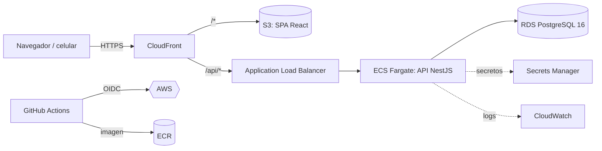

# Arquitectura — Sistema de Administración de Complejos

Sistema web responsive para administrar complejos **residenciales y recreativos**: finanzas, servicios, personal y marcación con ubicación. Este documento registra las decisiones de diseño (estilo ADR) para que el equipo las entienda y las pueda discutir.

## 1. Vista general

| Capa | Tecnología | Por qué |
|---|---|---|
| Frontend | React 18 + Vite + Tailwind 4 + TanStack Query + Recharts | SPA rápida, mobile‑first, caché de datos y reintentos sin código extra |
| API | NestJS 11 (monolito modular) | Módulos por dominio, inyección de dependencias, guards; fácil de dividir después |
| Datos | PostgreSQL 16 + Drizzle ORM | SQL tipado sin binarios; migraciones versionadas en `apps/api/drizzle` |
| Validación | Zod en cada endpoint | Un solo esquema valida y tipa la entrada |
| Infra | AWS CDK (TypeScript) | Infraestructura como código, reproducible por entorno |
| CI/CD | GitHub Actions + OIDC | Sin llaves de AWS guardadas en GitHub |

## 2. Decisiones clave

### ADR‑1 · Multi‑tenant por fila
Una cuenta puede administrar varios complejos. Toda tabla de negocio lleva `complex_id`; el `AuthGuard` global exige el header `X-Complex-Id`, verifica la **membresía** del usuario y aplica el **rol**. Ninguna consulta se ejecuta sin el filtro de complejo.
*Evolución:* activar Row‑Level Security de PostgreSQL como segunda barrera cuando haya más de un equipo desarrollando.

### ADR‑2 · Contabilidad de partida doble
Ingresos, egresos, servicios y saldo inicial **no** suman a un campo “saldo”: generan asientos (`journal_entries` / `journal_lines`) contra un catálogo de cuentas por complejo. De ahí salen, sin lógica duplicada:
- Estado de resultados, Balance general (con verificación Activo = Pasivo + Patrimonio) y Flujo de efectivo.
- Saldo de caja, KPIs del panel y series para proyecciones.

Catálogo base: `1100 Caja y bancos`, `3100 Fondo inicial`, `41xx–49xx` ingresos (cuotas, amenidades, servicios, multas…), `51xx–59xx` gastos (planilla, servicios públicos, mantenimiento, seguridad…). El usuario puede crear categorías `4xxx`/`5xxx` propias.

### ADR‑3 · Nada se borra: se anula
Un ingreso/egreso/servicio registrado se **anula** con motivo; el sistema genera el asiento de reversión y lo deja en `audit_logs`. Esto preserva la pista de auditoría que exigen las juntas directivas y auditores.

### ADR‑4 · Dinero exacto
Columnas `NUMERIC(14,2)`; en memoria se opera en **centavos enteros** (`common/money.ts`). Nunca `float` para montos.

### ADR‑5 · Servicios con costo y precio congelados
El catálogo define costo y precio unitario. Al registrar un servicio brindado se **copian** al registro (si el catálogo cambia, la historia no). Opcionalmente genera el ingreso (`4300`) y el costo (`5700`) en la misma transacción → rentabilidad por servicio.

### ADR‑6 · Marcación con geolocalización
- El navegador captura GPS (`enableHighAccuracy`) y envía lat/lng, precisión y hora del dispositivo.
- **La hora válida es la del servidor**; la del dispositivo se guarda para detectar relojes manipulados (> 5 min de desfase se señala).
- Se calcula la **geocerca** más cercana (Haversine) con tolerancia por precisión (máx. 50 m extra).
- Política configurable: *exigir geocerca* (rechaza fuera de zona) o *señalar* (acepta y marca para revisión).
- Se impide doble entrada/salida; el reporte empareja turnos y señala: fuera de zona, sin salida, turno > 16 h, GPS impreciso, registro manual.
- Se guarda IP y user‑agent como evidencia.

### ADR‑7 · Proyecciones explicables
Suavizado exponencial de Holt (nivel + tendencia); con ≥ 24 meses se agrega estacionalidad mensual. Proyección anual = real a la fecha + proyectado. Autonomía = caja ÷ gasto promedio de 3 meses cerrados; se estima el mes en que la caja se agotaría. Se prefirió un modelo simple y auditable sobre uno “caja negra”.

### ADR‑8 · Seguridad
JWT de acceso corto (15 min) + refresh (7 días) con **versión de token** en el usuario: cambiar contraseña o “cerrar todas las sesiones” invalida todo. bcrypt (12 rondas), `helmet`, rate‑limit (más estricto en login/registro), validación Zod, secretos en Secrets Manager, BD en subred aislada y cifrada.

## 3. Roles

| Rol | Puede |
|---|---|
| Propietario / Administrador | Todo: ajustes, usuarios, unidades, empleados, geocercas, finanzas |
| Contador | Registrar y anular ingresos/egresos/servicios; ver informes |
| Consulta | Ver finanzas e informes |
| Personal | Marcar su entrada/salida y ver sus marcaciones |

## 4. Módulos de la API (`/api`)

| Módulo | Endpoints principales |
|---|---|
| Cuenta | `POST auth/register · auth/login · auth/refresh · auth/logout-all` · `GET/PATCH me` · `POST me/password` |
| Complejos | `POST complexes` · `GET/PATCH complexes/current` (incl. saldo inicial) · `GET/POST complexes/current/members` |
| Catálogo | `GET/POST accounts` |
| Unidades | `GET/POST/PATCH units` |
| Ingresos / Egresos | `GET/POST incomes`, `POST incomes/:id/void` (ídem `expenses`) |
| Servicios | `GET/POST/PATCH services` · `GET/POST service-records` · `GET service-records/summary` · `POST service-records/:id/void` |
| Personal | `GET/POST/PATCH employees` · `GET/POST/PATCH/DELETE geofences` |
| Marcación | `POST attendance/clock` · `GET attendance/me · attendance/entries · attendance/report` |
| Informes | `GET reports/dashboard · reports/monthly-expenses · reports/income-statement · reports/balance-sheet · reports/cash-flow` |
| Análisis | `GET analytics/projections · analytics/annual` |

## 5. Hoja de ruta sugerida (para ir afinando)

1. **Cuotas y morosidad:** generación mensual de cargos por unidad (cuentas por cobrar `1200`), estado de cuenta por residente y recargos automáticos.
2. **Presupuesto anual** por categoría y comparativo real vs. presupuesto.
3. **Comprobantes:** subir facturas/recibos a S3 con URL firmada.
4. **Verificación de correo y recuperación de contraseña** con Amazon SES.
5. **Marcación avanzada:** foto (selfie) opcional, modo kiosco en portería, funcionamiento sin conexión (PWA) con sincronización.
6. **Planilla:** convertir horas aprobadas en egreso de planilla (`5100`) con un clic.
7. **Exportación** de informes a Excel y PDF con membrete; facturación electrónica (DTE) si aplica.
8. **Portal del residente**, amenidades con reservas, caseta (visitas/paquetes) — como en la imagen de referencia.
9. Observabilidad: alarmas de CloudWatch, WAF en CloudFront, Multi‑AZ en RDS.
